

<a href="https://app.nova3d.xyz">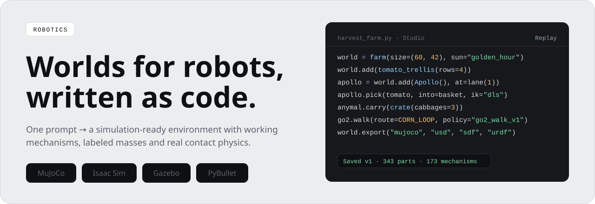</a>

<a href="https://nova3d.xyz"> website</a> · <a href="https://app.nova3d.xyz"> open studio</a> · <a href="https://arxiv.org/abs/2607.22738"> paper</a> · <a href="https://discord.gg/QEH8mzcwdR"> discord</a> · <a href="https://x.com/nova3d_ai"> X</a> · <a href="https://github.com/RareSense/Nova3D/issues"> issues</a>

 

*A working farm, written by Nova3D from one prompt. Humanoids pick tomatoes, quadrupeds carry the harvest, drones scout. Simulated and filmed in MuJoCo.*

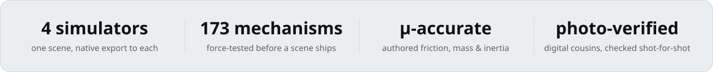

 

<samp>worlds</samp>

## Robots at work.

Every world below started as a text prompt, was generated as an **executable scene program**, compiled to MuJoCo, and populated with robots. Doors open on real hinges, produce carries labeled masses, floors carry measured friction. The environment is code, so every physical property is authored, not painted on.

<table align="center">
  <tr>
    <td align="center" width="33%"> <b>Café</b> · Unitree G1 waiters clear tables; a Go2 serves from its back <i>(learned walking policy, full physics)</i></td>
    <td align="center" width="33%"> <b>Mall</b> · Spot patrols, H1 delivers parcels, Stretch restocks, a Skydio X2 flies the atrium</td>
    <td align="center" width="33%"> <b>Farm</b> · Apptronik Apollo picks tomatoes into a basket; ANYmal hauls the crate</td>
  </tr>
  <tr>
    <td align="center" width="33%"> <b>Apartment</b> · a G1 tidies a generated home, object by object</td>
    <td align="center" width="33%"> <b>Orbital lab</b> · a UR5e throws a sample across the module in zero g; a Franka Panda catches it in flight</td>
    <td align="center" width="33%"> <b>Traction hall</b> · one walking policy, three floors: ice μ 0.02, steel μ 0.30, rubber μ 1.05</td>
  </tr>
</table>

 

<samp>physics</samp>

## Real-life physics, built in.

Every scene Nova3D produces comes with real-life physics as part of the world itself: gravity, contact, friction, mass and inertia. Change one constant and the simulation answers. Here the same scene runs twice; the only difference is gravity.

<table align="center">
  <tr>
    <td align="center" width="50%"> <b>g = 0</b> · a Booster T1 pushes off the hatch with its legs and floats the length of the module, carried only by the momentum of that push</td>
    <td align="center" width="50%">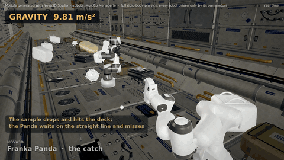 <b>g = 9.81 m/s²</b> · the identical throw now falls in a curve, and the catcher waiting on the straight line misses</td>
  </tr>
</table>

*The ramp tilts slowly, and the blocks let go in order of grip: the ice block slides at just 4.6°, steel at 15°, aluminium at 20°, oak at 26°, and the rubber block holds on to the very end. Nobody animated any of this. Each block slips at exactly the angle where physics says its grip runs out.*

 

<samp>validation</samp>

## Every mechanism opens before a scene ships.

The build pushes every door, drawer, lid and gate with the physics engine itself. A hinge that jams, a drawer that binds, a prop that floats: each one fails the build, by name.

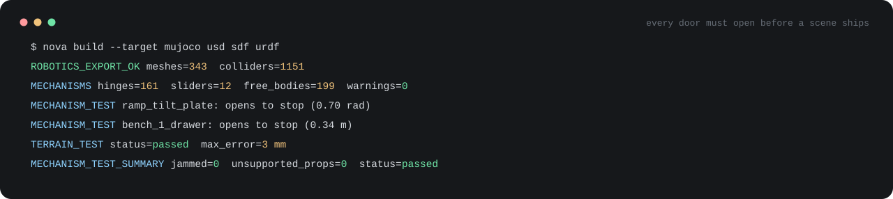

 

<samp>digital&nbsp;cousins</samp>

## A real place, rebuilt as a digital cousin.

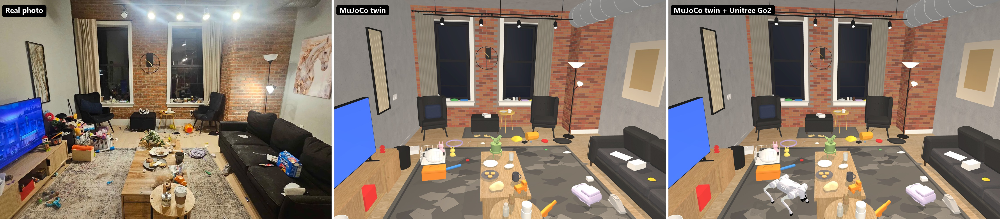
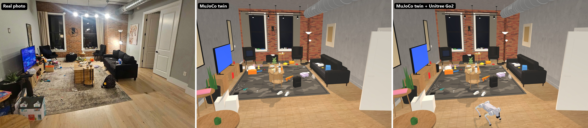
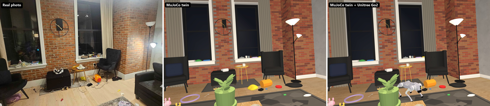

*Left: the photograph. Middle: the Nova3D digital cousin rendered in MuJoCo from the same camera. Right: the same scene with a Unitree Go2 walking through it. Cousins are rebuilt object by object from photos: every visible item counted, placed and sized against the originals, checked shot for shot from every angle.*

 

<samp>thesis</samp>

## A robot can't open a door that is one fused mesh.

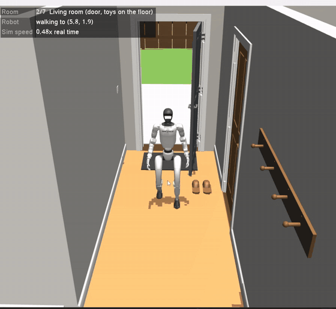

A G1 tours a generated house in MuJoCo and opens every door on its way, because every door is a real hinged body.

Mesh generators output vertex soup. Nova3D never builds fused meshes:

- **Named parts, real hierarchy.** `kitchen_door`, its hinge pin, its handle: separately addressable bodies.
- **Working mechanisms.** Hinges and sliders with limits, damping and clearances that survive contact simulation.
- **Labeled physics.** Every loose object carries mass, inertia and friction with stated provenance.
- **Verified, not vibed.** Mechanism force-tests, terrain probe-tests and photo-matched captures gate every build.

 

<samp>exports</samp>

## One source. Every engine.

A world written once opens wherever people build, play and train. Change the source and every target follows. For robotics the exports are native: MuJoCo (MJCF), Isaac Sim (USD), Gazebo (SDF) and PyBullet (URDF), the same environment everywhere, never four approximations.

Static structure exports with exact collision. Mechanisms export as native joints on every target. Outdoor ground exports as height fields, so feet collide with the actual hill, not its convex hull.

 

<samp>studio</samp>

## Worlds as software projects.

Nova3D builds 3D worlds as software projects you can edit, test and build on.

| **Keep building.** | **Decide what happens.** | **Build it together.** |
|---|---|---|
| Rebuild a part, add something new, or make another version. Every change is a saved version you can replay. | Add movement, controls and interactions to the things you build. | People and AI agents work in the same world at the same time, each on their own branch. The branches merge into one world. |

 

<b>Nova3D beyond robotics: general 3D asset generation</b> (click to expand)

 

Nova3D generates 3D assets as **executable construction procedures**: prompt-to-code targeting Blender's API, compiling to structured GLB with named parts, assembly hierarchy, joint pivots and PBR materials.

&nbsp;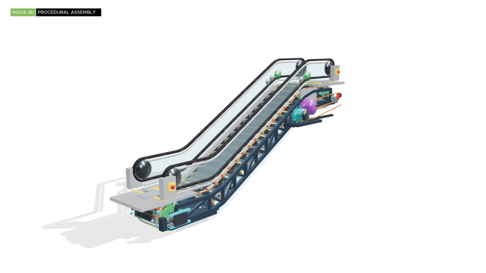&nbsp;

[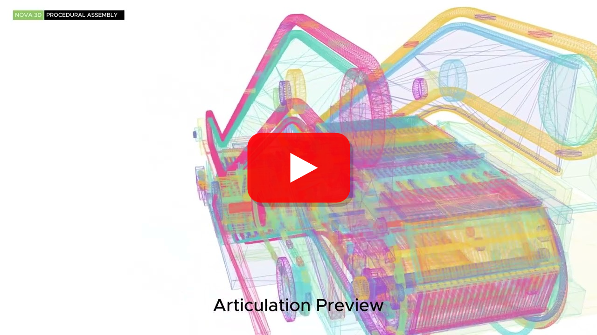](https://www.youtube.com/watch?v=309zNw0JETU)

**Comparisons:** [vs TRELLIS & Hunyuan3D](https://www.youtube.com/watch?v=iL_NX_hBq9k) · [vs NVIDIA PartPacker & Tripo segmentation](https://www.youtube.com/watch?v=msGZs4EMnvs)

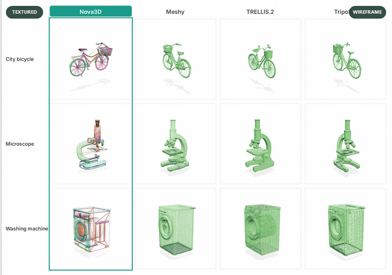

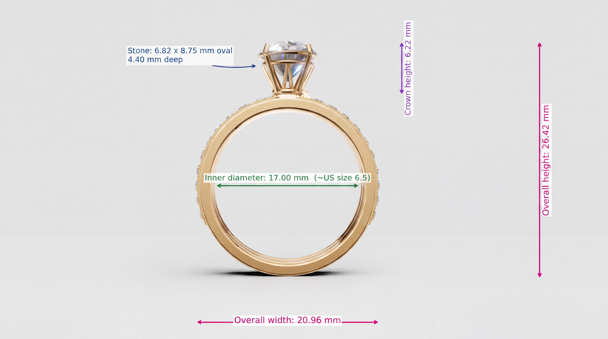

*Prompt-stated dimensions hold up when measured back from the result: a ring generated to 17.00 mm inner diameter measures 17.00 mm.*

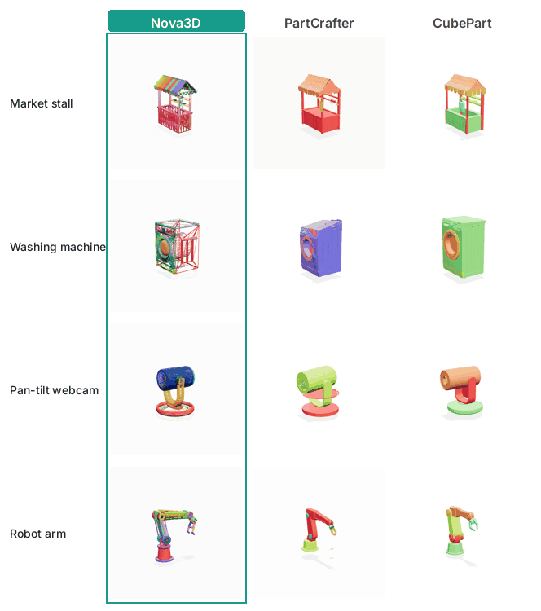

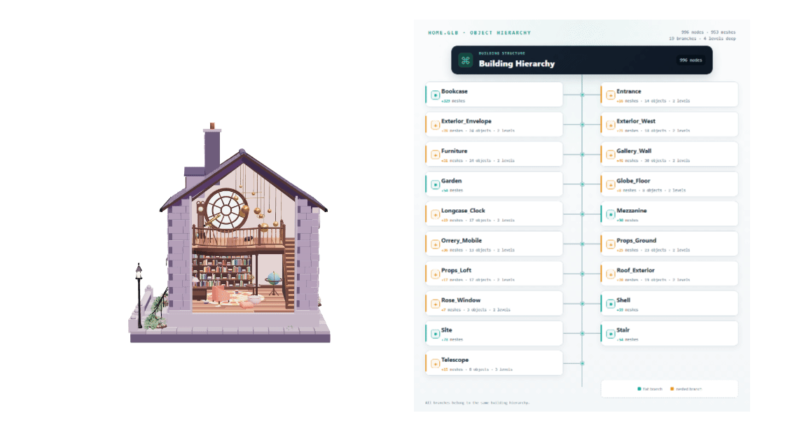

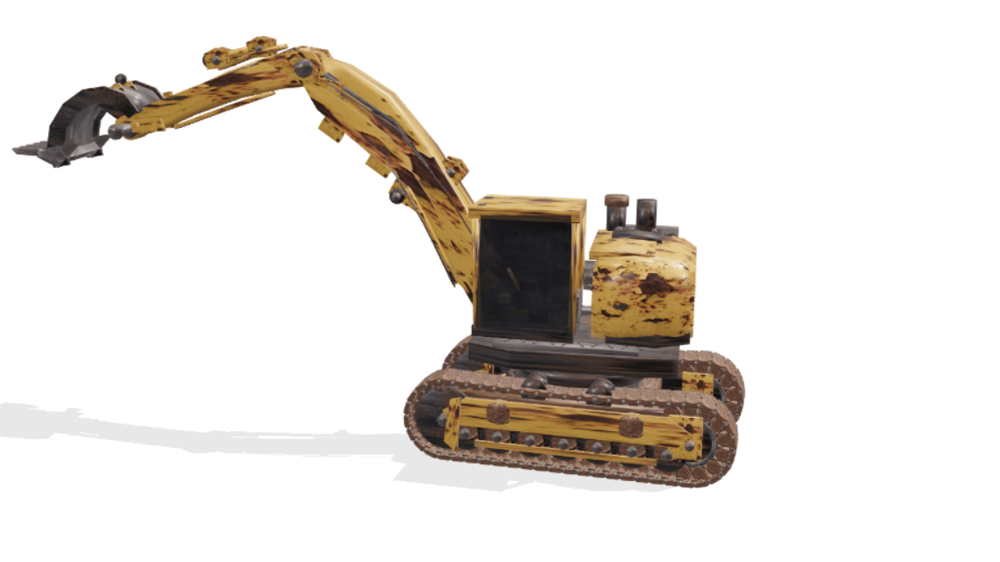

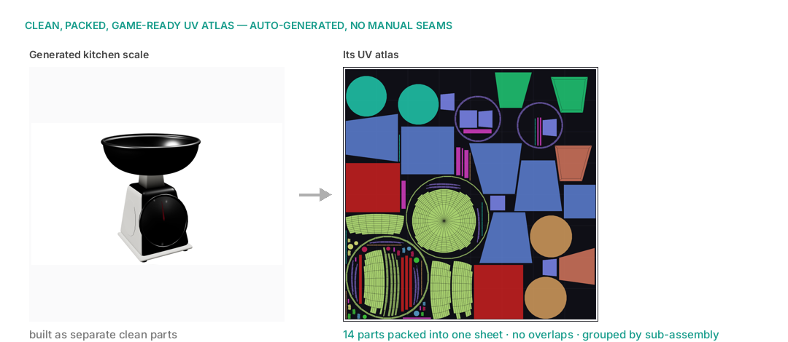

 

<samp>start</samp>

## Open Studio. Pick a cartridge.

New projects in Studio start from a cartridge. Pick **ROBOTICS** and the project is wired for MuJoCo, PyBullet, Gazebo and Isaac Sim from the first prompt.

<a href="https://app.nova3d.xyz">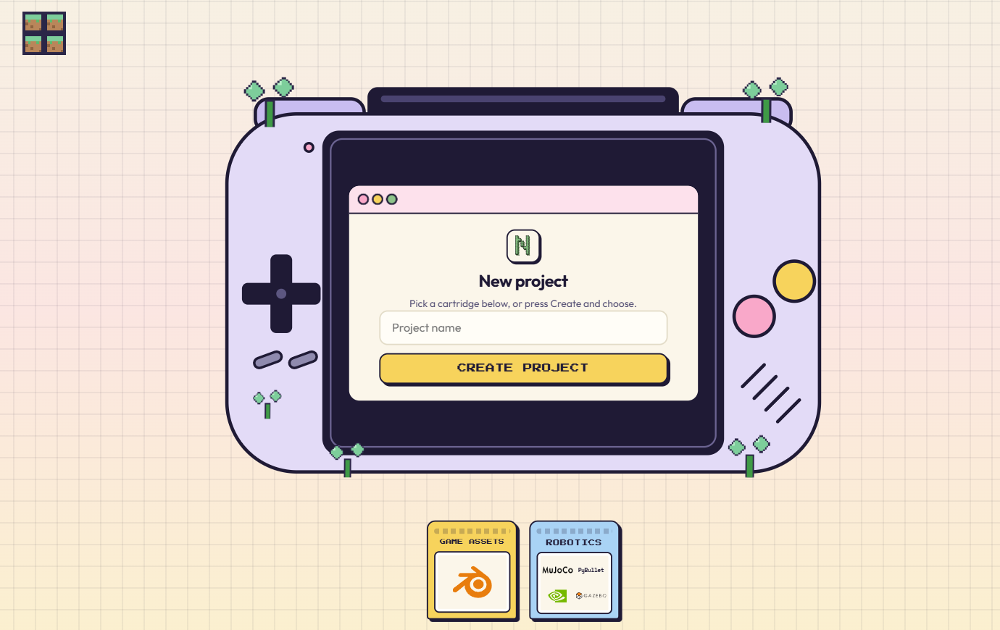</a>

<a href="https://app.nova3d.xyz"><b>Open Studio ↗</b></a> · no local backend required

 

This repository is the home of Nova3D's open clients and integrations: the [web client](app/), the [MCP server](mcp/) and the [Blender add-on](blender-plugin/).

> Robot models in the films are from the [MuJoCo Menagerie](https://github.com/google-deepmind/mujoco_menagerie);
> the worlds, physics setups, controllers and films are Nova3D.

 

<a href="https://app.nova3d.xyz">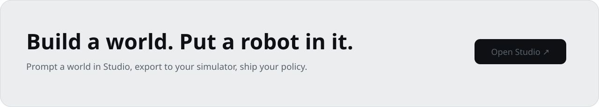</a>

## License

[MIT](LICENSE) © RareSense. The clients and integrations in this repository are open-source.

  <small>Built on the same engine powering <b><a href="https://formanova.ai">FormaNova</a></b> for specialized jewelry CAD.</small>

