

<a href="https://nova3d.xyz">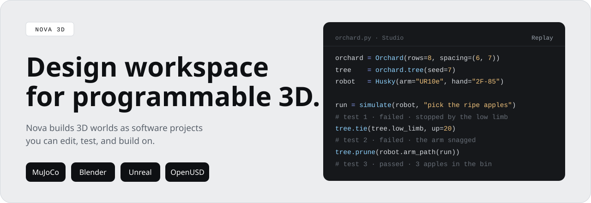</a>

<a href="https://nova3d.xyz"> website</a> · <a href="https://app.nova3d.xyz"> open studio</a> · <a href="https://arxiv.org/abs/2607.22738"> paper</a> · <a href="https://discord.gg/QEH8mzcwdR"> discord</a> · <a href="https://x.com/nova3d_ai"> X</a> · <a href="https://github.com/RareSense/Nova3D/issues"> issues</a>

 

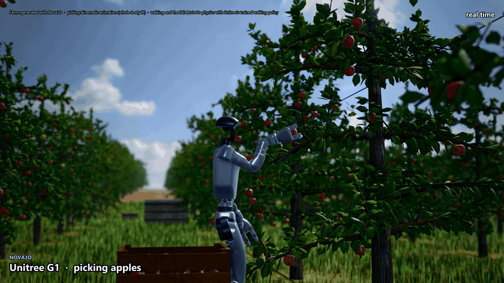

*A working farm, written by Nova3D from one prompt. Humanoids pick tomatoes, quadrupeds carry the harvest, drones scout. Simulated and filmed in MuJoCo.*

 

## Capabilities

1. **Executable source:** represent assets and environments as programs that can be inspected, edited, and rebuilt.
2. **Parametric control:** define dimensions, proportions, materials, physical properties, and motion through explicit parameters.
3. **Controlled variation:** specify which parameters change and which remain fixed across design alternatives or experiments.
4. **Structural editing:** change components, assemblies, layouts, clearances, and connections through their construction code.
5. **Reusable construction:** reuse components and generation logic to build related designs, asset families, and environments.
6. **Programmable motion:** define articulation, animation, interactive controls, and prescribed object trajectories.
7. **Geometry and motion checks:** inspect dimensions, part relationships, pivots, and collisions, using checks appropriate to the design.
8. **Versioned development:** preserve source, parameters, build outputs, and validation results as the project evolves.
9. **Target-specific exports:** compile designs for CAD tools, 3D applications, and robotics simulators through dedicated export paths.

### For robotics

1. **Controlled scenario generation:** specify which geometric, physical, and temporal parameters change, and which remain fixed.
2. **Structural variation:** change connectivity, obstacle arrangement, clearances, and mechanism configurations, not just textures or initial positions.
3. **Reproducible evaluation:** preserve the environment source, parameters, simulator configuration, and experiment results.
4. **Failure-driven generation:** eventually turn a failed rollout into a family of nearby scenarios to investigate the failure boundary.

 

## Describe it. Build it. Keep going.

Start with an idea and keep shaping it. Change the geometry, add motion and behavior, and explore new versions.

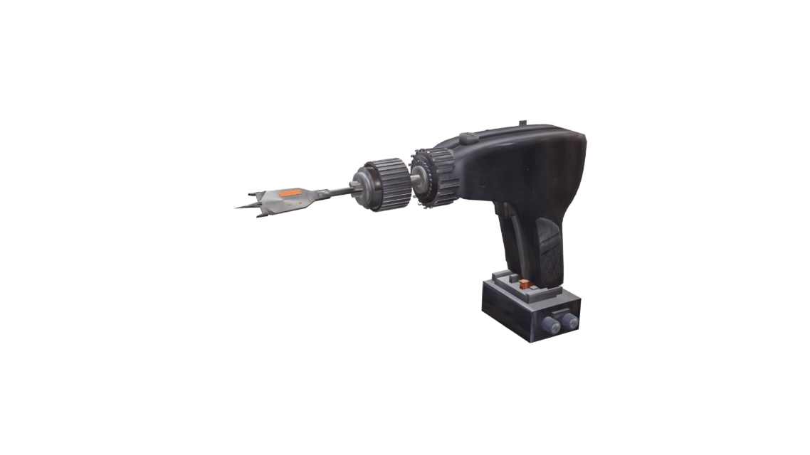&nbsp;&nbsp;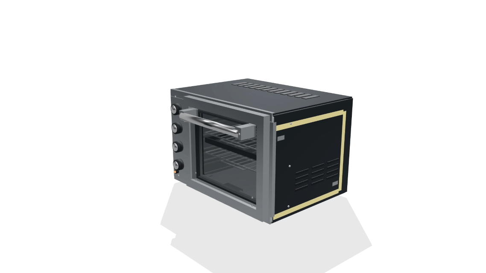

A drill, an escalator and an oven, each built part by part: assembled, taken apart, and seen through to every piece inside.

<table align="center">
  <tr>
    <td align="center" width="33%"><a href="https://nova3d.xyz/#keep-building">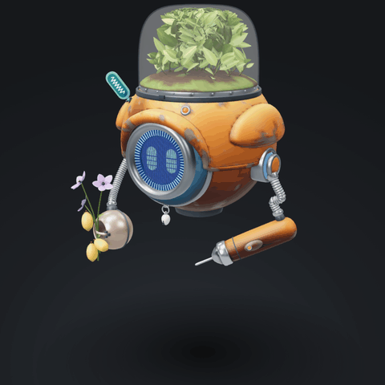</a> <b>gardener_bot</b> <i>Animate his arm changing from the probe into the can, and make him water the plants.</i></td>
    <td align="center" width="33%"><a href="https://nova3d.xyz/#keep-building">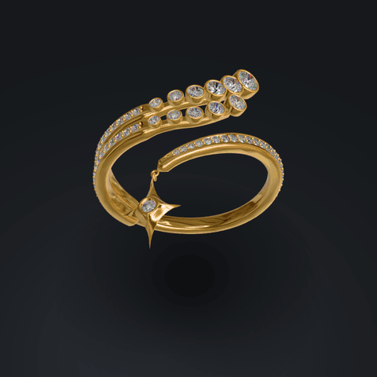</a> <b>shooting_star</b> <i>Make this ring.</i> → <i>Turn it into a pair of matching earrings.</i> → <i>Make the earrings rose gold.</i> → <i>Change the earring shape into a rising-star climber.</i></td>
    <td align="center" width="33%"><a href="https://nova3d.xyz/#keep-building">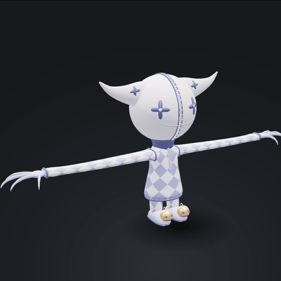</a> <b>harlequin_doll</b> <i>Animate his head unzipping, and a bright glowing moon floating out of it.</i></td>
  </tr>
</table>

 

## Build it together.

People and AI agents work in the same world at the same time, each on their own branch. Then the branches merge into one world.

<table align="center">
  <tr>
    <td align="center" width="33%">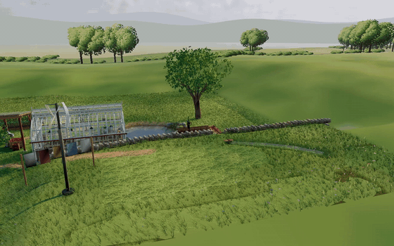 <b>You</b>: <i>Build a cottage on the empty plot, with a glass tower.</i> v1 · 53 parts</td>
    <td align="center" width="33%">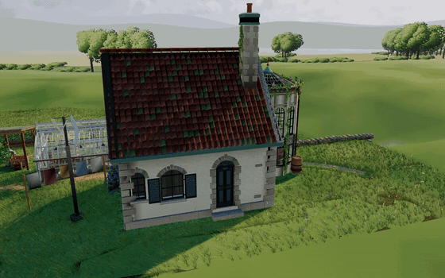 <b>Maya</b>: <i>I want to see inside. Open up the back.</i> v2 · 19 new parts inside</td>
    <td align="center" width="33%"> <b>Sam</b>: <i>What does it look like in winter?</i> v3 · snow, bare trees, frozen pond</td>
  </tr>
  <tr>
    <td align="center" width="33%">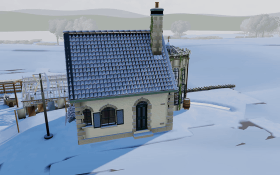 <b>Sam</b>: <i>Now make it night.</i> v4 · 9 lamps and the fire lit</td>
    <td align="center" width="33%">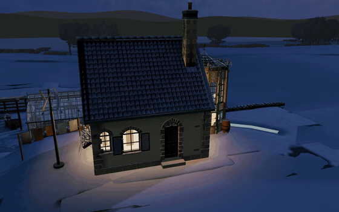 <b>You</b>: <i>Merge Maya's open back with Sam's winter night.</i> v5 · no conflicts</td>
    <td align="center" width="33%">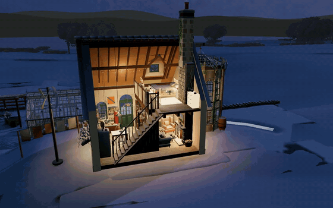 <b>Maya</b>: <i>Send the gardener bot in to water the plants.</i> v6 · in through the open back</td>
  </tr>
</table>

 

<samp>worlds</samp>

## Robots at work.

Every world below started as a text prompt, was generated as an **executable scene program**, compiled to MuJoCo, and populated with robots. Doors open on real hinges, produce carries labeled masses, floors carry measured friction. The environment is code, so every physical property is authored, not painted on.

<table align="center">
  <tr>
    <td align="center" width="33%">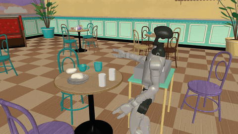 <b>Café</b> · Unitree G1 waiters clear tables; a Go2 serves from its back <i>(learned walking policy, full physics)</i></td>
    <td align="center" width="33%">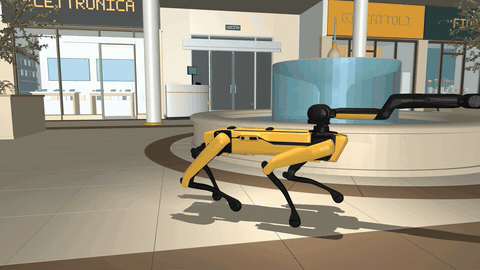 <b>Mall</b> · Spot patrols, H1 delivers parcels, Stretch restocks, a Skydio X2 flies the atrium</td>
    <td align="center" width="33%">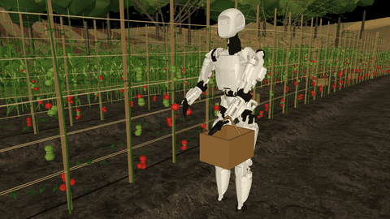 <b>Farm</b> · Apptronik Apollo picks tomatoes into a basket; ANYmal hauls the crate</td>
  </tr>
  <tr>
    <td align="center" width="33%">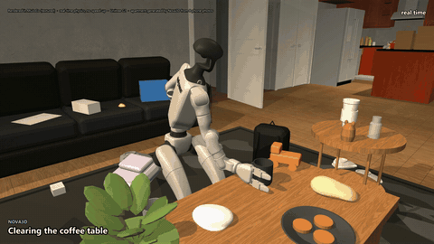 <b>Apartment</b> · a G1 tidies a generated home, object by object</td>
    <td align="center" width="33%">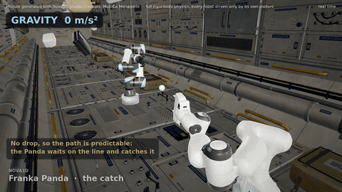 <b>Orbital lab</b> · a UR5e throws a sample across the module in zero g; a Franka Panda catches it in flight</td>
    <td align="center" width="33%">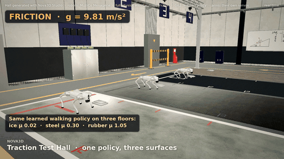 <b>Traction hall</b> · one walking policy, three floors: ice μ 0.02, steel μ 0.30, rubber μ 1.05</td>
  </tr>
</table>

 

## Simulate. Test. Revise.

Run your designs in simulation to check movement, collisions, and interactions. Find what fails, revise the design, and test it again.

<table align="center">
  <tr>
    <td align="center" width="33%">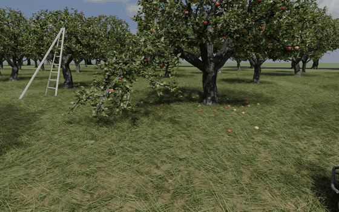 <b>Test 1 · failed</b> <i>Husky, pick the ripe apples off this tree.</i> The low limb stops it at 50 cm.</td>
    <td align="center" width="33%">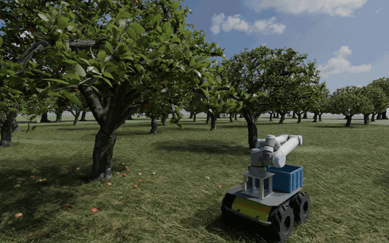 <b>v2 · the low limb tied up 20°</b> <b>Test 2 · failed</b>: the arm snags on branches, 0 of 3 apples picked.</td>
    <td align="center" width="33%">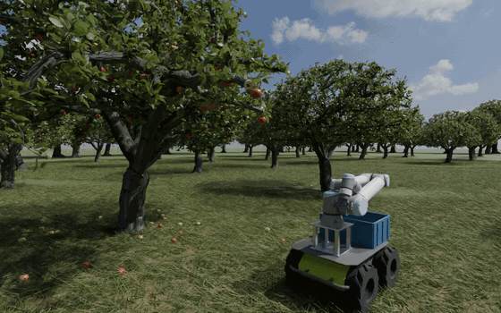 <b>v3 · 6 branches pruned out of the arm's path</b> <b>Test 3 · passed</b>: 3 ripe apples in the bin, nothing knocked.</td>
  </tr>
</table>

A Clearpath Husky with a UR10e arm and a Robotiq 2F-85 gripper, in an old orchard grown as code. Asked to <i>adapt this tree for this robot and keep every apple</i>, Nova revises the tree and tests again. Every move is the MuJoCo run: branches bend and spring back, stems snap only when pulled or lifted.

<table align="center">
  <tr>
    <td align="center" width="33%">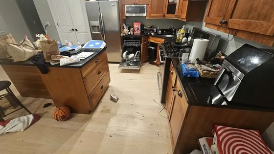 <b>The real kitchen</b> The scene was built from 8 phone photos.</td>
    <td align="center" width="33%">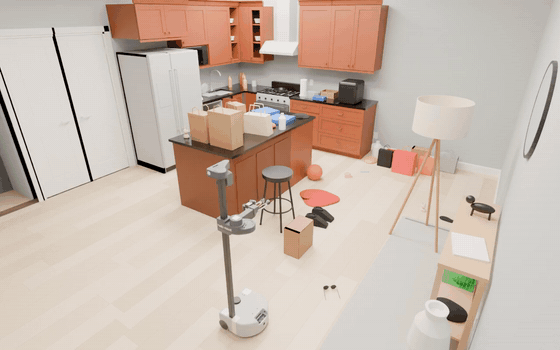 <b>Test 1 · failed</b> <i>Stretch, get the milk off the island.</i> It bumps the bar stool, 1.1 m short.</td>
    <td align="center" width="33%">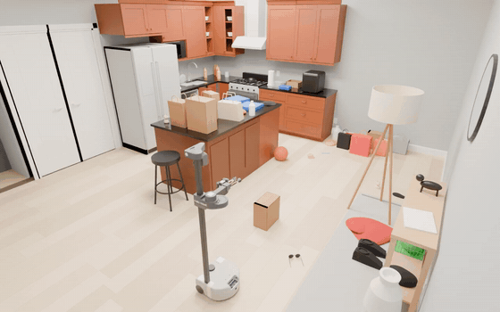 <b>v2 · adapted for Stretch, design kept</b> <b>Test 2 · passed</b>: 4 things moved out of its path, milk in hand at 11 s.</td>
  </tr>
</table>

 

<samp>physics</samp>

## Physics, defined in source.

Mass, inertia, friction, and joint limits are explicit and editable alongside the geometry. Change the conditions and simulate the result. Below, the same scene runs with one parameter changed: gravity, from 0 to 9.81 m/s².

<table align="center">
  <tr>
    <td align="center" width="50%">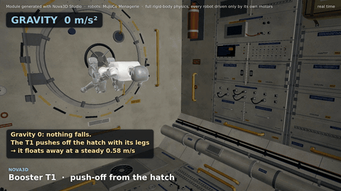 <b>g = 0</b> · a Booster T1 pushes off the hatch with its legs and floats the length of the module, carried only by the momentum of that push</td>
    <td align="center" width="50%">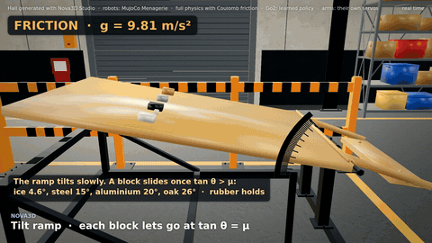 The ramp tilts slowly, and the blocks let go in order of grip: the ice block slides at just 4.6°, steel at 15°, aluminium at 20°, oak at 26°, and the rubber block holds on to the very end. Nobody animated any of this. Each block slips at exactly the angle where physics says its grip runs out.</td>
  </tr>
</table>

 

## Build on common ground.

Bring assets, scenes, and behavior together in one programmable project. Build from the same source for design tools, game engines, and simulators.

<a href="https://nova3d.xyz">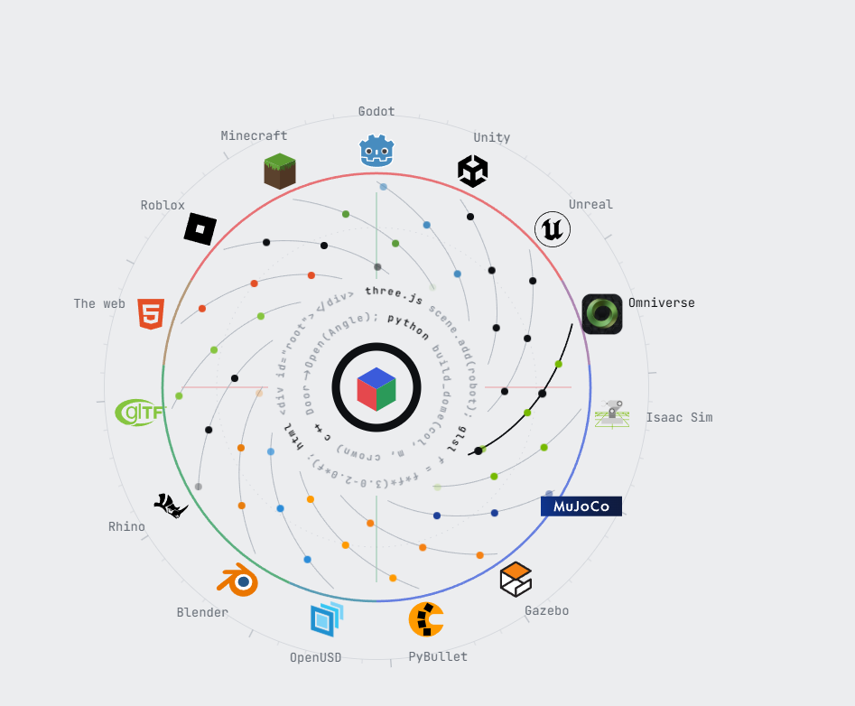</a>

 

## License

[MIT](LICENSE) © RareSense.

  <small>Built on the same engine powering <b><a href="https://formanova.ai">FormaNova</a></b> for specialized jewelry CAD.</small>

