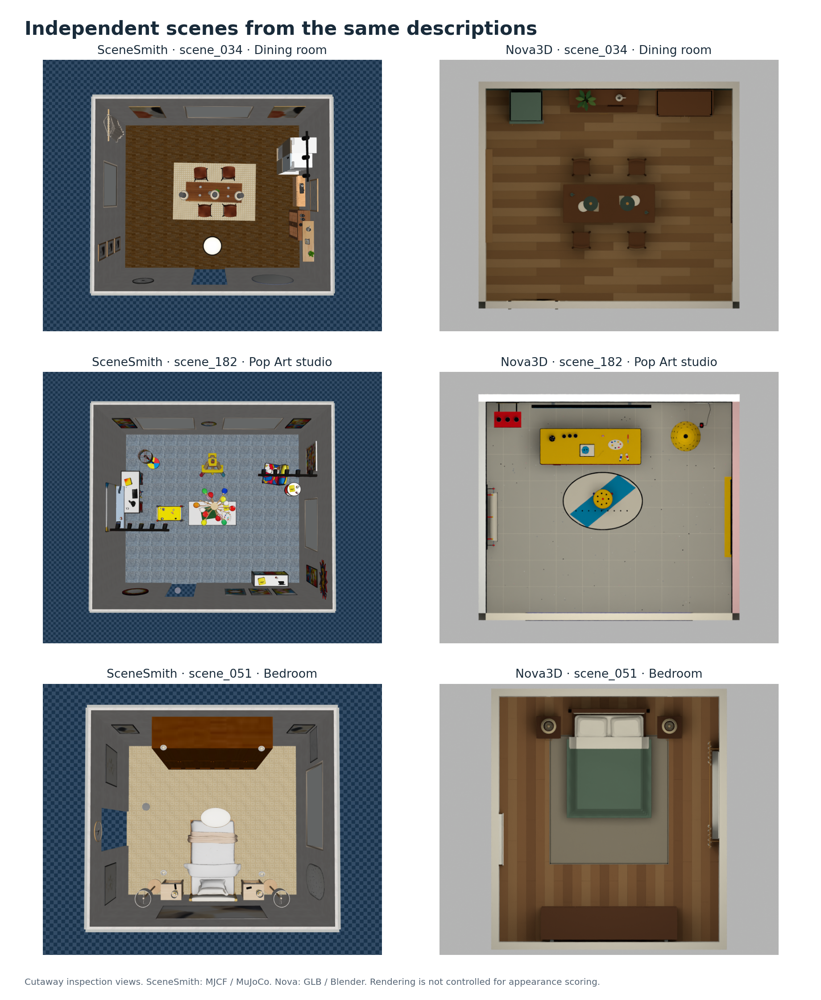

# SceneSmith and Nova3D: paired scenes and research capabilities

The same 20 text descriptions produced two sets of independently generated environments. This comparison covers the **construction representation, available annotations, interaction structure, physical controls, and released formats** for those exact scene IDs.

## Capability comparison

| Capability | SceneSmith's selected outputs | Nova3D's selected outputs |
|---|---|---|
| **Scene authoring** | Blender scenes and declarative assembly files; open-source generation framework | A generated Python construction program for every scene, defining geometry, layout, appearance, and mechanisms |
| **Geometry variation** | Scene and asset editing through native files and the SceneSmith framework | Construction constants and functions in each scene's source, including room, furniture, and mechanism dimensions |
| **Semantic and spatial access** | Named models, transforms, and native asset structures | Separate part IDs, semantic labels, bounds, dimensions, and body records in JSON |
| **Articulation** | 87 revolute/prismatic joints across 11 scenes | 93 hinge/slide joints across 18 scenes |
| **Movable content** | 1,070 free joints declared in MJCF | 1,341 free joints declared in MJCF |
| **Physical controls** | Joint, inertia, friction, and other properties in simulator files | Native physical properties plus separate annotations; a measured parameter-change example is included below |
| **Scene assembly for simulation** | Drake scene descriptions, MJCF, USD, and SDF assets | MJCF, USD, an assembled SDF world, and a PyBullet scene runner |
| **Visual editing and inspection** | Blender scene, textured assets, and MJCF material declarations | Whole-scene GLB, generated source, textures, and part metadata; current MJCF uses per-part colors |

These differences describe the selected releases. A model instance, mesh part, free joint, and inventory object are different units; their counts are not interchangeable measures of object completeness.

## Inspect the same descriptions

The panels show the first three selected pairs, preserving the original IDs. They are cutaway inspection views: SceneSmith is rendered from MJCF in MuJoCo; Nova from GLB in Blender. They illustrate scene content and structure, rather than a controlled rendering score.

## Geometry as an editing surface

In `scene_034`, room width/depth/height, table dimensions, shelf width, and refrigerator width are explicit construction constants. The program also builds furniture components, materials, and mechanisms. This gives researchers access to how geometry is created, alongside its final exported meshes.

## Part-level access to interactions

The dining room contains separate refrigerator doors, wine-cabinet doors, a serving drawer, movable stools, and tableware. IDs connect these parts to their geometry and physical records. SceneSmith also provides articulated appliances: its refrigerator in this pair is not a static-only mesh. The relevant comparison is which interactions each assembled scene supplies and how those entities can be inspected and modified.

## A measured physical intervention

For `scene_182`, we ran the full released Nova MJCF under three conditions. Each trial resets the scene and applies 15.8 N directly to the drawer joint for one second. The original 0.36 m travel limit, a shortened 0.18 m limit, and increased 20 N joint friction produce different measured trajectories. No geometry is regenerated and no poses are prescribed during simulation.

This demonstrates a controlled physical intervention on the supplied scene. It is not a robot-contact or policy-training result. [Runnable example and exact settings](https://huggingface.co/datasets/BoooomNing/nova-scenesmith/blob/main/examples/README.md).

## Articulation across all 20 pairs

Nova has more declared joints in 13 pairs, equal counts in two, and fewer in five. These are articulation declarations; successful task execution and prompt completeness are separate questions.

## Natural-language editing workflow

Nova Studio provides the editing interface above the scene program. Example requests can address geometry, layout, appearance, or physical behavior:

- “Make the central table 2.6 metres wide and retain the surrounding seating clearance.”
- “Keep the studio layout, shorten the drawer travel to 18 centimetres, and increase its resistance.”
- “Move the cabinet to the opposite wall and preserve its opening direction.”

These are example editing requests, not transcripts of additional generations in this release. The dataset supplies the resulting scene programs and annotations for subsequent work. [Open Nova Studio](https://studio.nova3d.xyz).

## Evidence and downloads

[Paired-scene CSV](https://huggingface.co/datasets/BoooomNing/nova-scenesmith/resolve/main/comparison/paired-scenes.csv) · [Complete declaration inspection](FILE_INSPECTION.md) · [Example measurements and reproduction](https://huggingface.co/datasets/BoooomNing/nova-scenesmith/blob/main/examples/README.md) · [Selection and provenance](https://huggingface.co/datasets/BoooomNing/nova-scenesmith/blob/main/docs/PROVENANCE.md)

Evidence covers a static inspection of all 20 pairs, illustrated examples from three pairs, and a controlled physical intervention in the studio scene. The original generations used different models and budgets. Prompt accuracy, task completion, and policy transfer require their own evaluation protocols.
