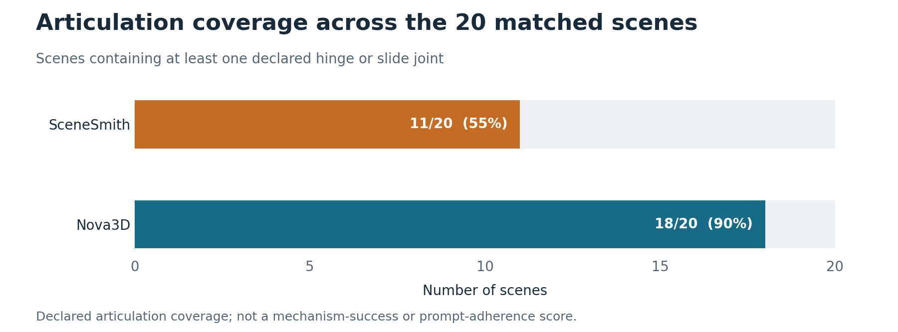
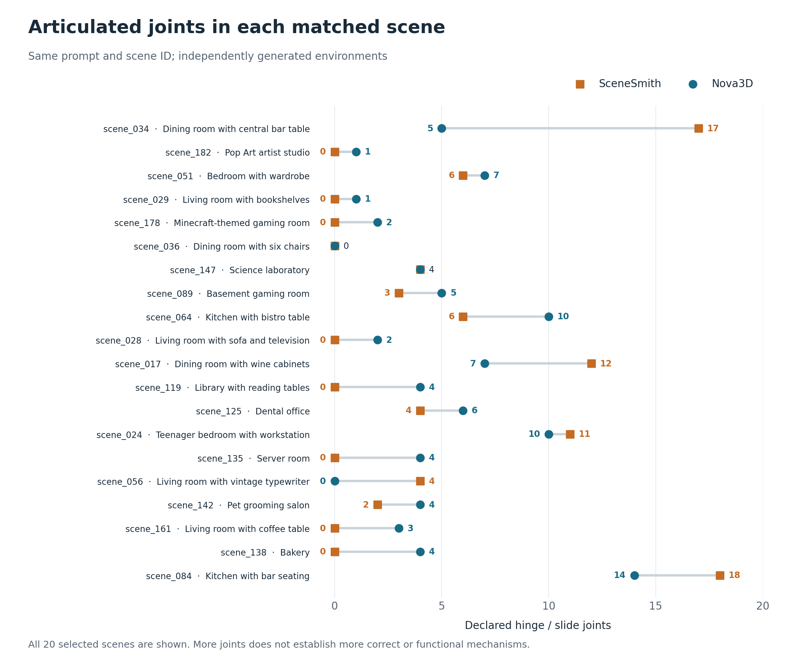

# Nova3D and SceneSmith: the same 20 scene descriptions

Nova3D and SceneSmith independently generated scenes from the same 20 text descriptions. The figures below compare the released scene files, with all selected IDs included.

## Articulation coverage

**Nova includes hinge or slide joints in 18 of 20 scenes (90%); SceneSmith includes them in 11 (55%).** This is a 35-percentage-point difference in the presence of authored articulation in this sample.

## Results for every scene

Nova has more declared joints in **13 pairs**, the same number in **two**, and fewer in **five**. Across all 20 scenes, Nova has **93** hinge/slide joints and SceneSmith has **87**.

These figures measure **authored articulation**, not whether the mechanisms work or satisfy the prompt. The counts were checked against both source declarations and MJCF exports. Models and generation budgets differ between the original runs.

## What researchers receive

| Released content | SceneSmith | Nova3D |
|---|---|---|
| Editable scene | Blender scene; Drake assembly descriptions | Per-scene procedural Python program |
| Labels and dimensions | Named models and transforms in native files | Separate part labels, IDs, bounds, and measurements |
| Mechanisms and physics | Joint and body properties in native scene files | Joint and body properties in native files and separate annotations |
| Simulation files | MJCF, USD, SDF assets; Drake scene descriptions | MJCF, USD, assembled SDF world; PyBullet runner |
| Browser geometry | Individual glTF assets | Assembled scene GLB |
| MuJoCo appearance | Texture and material declarations | Per-part RGBA colors; texture files supplied elsewhere in the scene package |

Nova's distinct contribution here is the **per-scene procedural source and separately accessible annotations**, alongside broader declared-articulation coverage in this sample. SceneSmith already provides articulation, physical properties, and editable scenes.

## Data and method

[Per-scene data and paired downloads](https://huggingface.co/datasets/raresense/nova-scenesmith/resolve/main/comparison/paired-scenes.csv) · [Complete file and declaration inspection](FILE_INSPECTION.md) · [Plot data](figures/plot-data.csv)

Figures: [coverage PDF](figures/articulation-coverage.pdf) / [SVG](figures/articulation-coverage.svg), [per-scene PDF](figures/paired-joint-counts.pdf) / [SVG](figures/paired-joint-counts.svg).

Each CSV row links to the original SceneSmith archive and its matching Nova archive. The detailed inspection retains file hashes, source revisions, model and part records, and native joint declarations. Object completeness, layout accuracy, visual quality, and mechanism success have not yet been scored for all 20 pairs; these graphs do not establish those outcomes.
