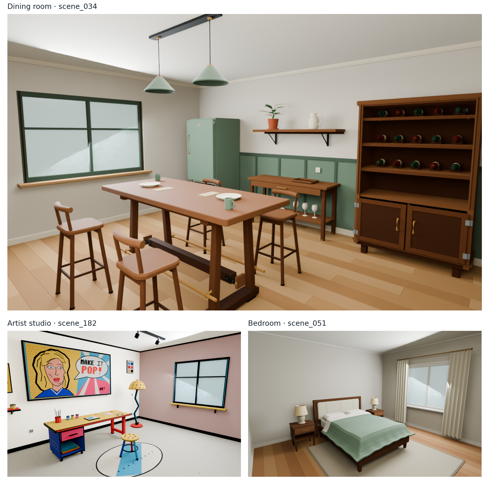
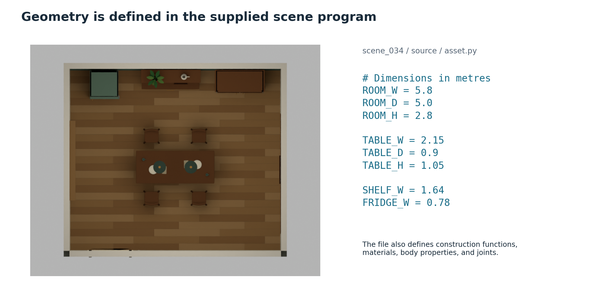
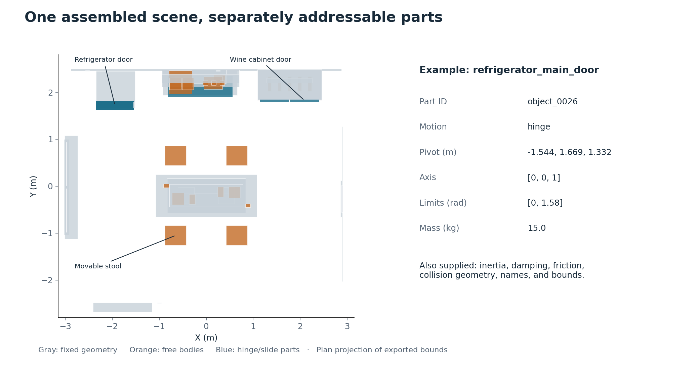
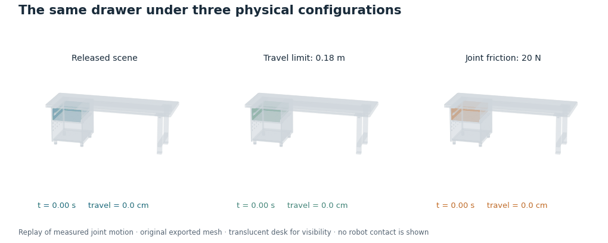
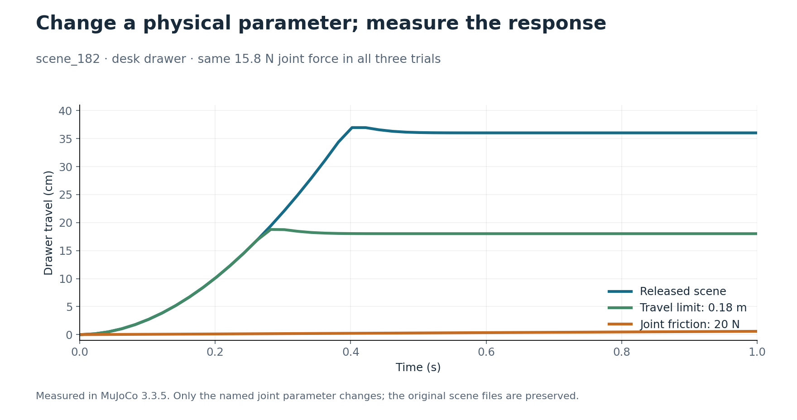

# Procedural Indoor Environments for Robot Simulation

[Nova3D Website](https://nova3d.xyz) · [Open Nova Studio](https://studio.nova3d.xyz)

**20 indoor environments represented as editable scene programs, with part-level annotations, articulated mechanisms, movable objects, and native simulator exports.** Generated with [Nova3D](https://nova3d.xyz/robotics) from the descriptions released by [SceneSmith](https://scenesmith.github.io/), the collection pairs each Nova scene with the corresponding original SceneSmith output.

[SceneSmith (Pfaff et al., ICML 2026)](https://proceedings.mlr.press/v306/pfaff26a.html) is developed by researchers at **MIT and Toyota Research Institute**. Both systems generated their scenes independently from the same text descriptions. The 20 Nova runs used **GPT-6 Astra**.

The collection includes **four living rooms, three dining rooms, two bedrooms, two kitchens, two recreation rooms, and seven specialized settings**: an artist studio, laboratory, library, dental office, server room, pet grooming salon, and bakery.

## Contributions

| Capability | Included in this release | Research application |
|---|---|---|
| **Procedural scene construction** | Python programs defining geometry, dimensions, placement, materials, and mechanisms | Create controlled changes to scene construction and layout |
| **Addressable scene structure** | Part IDs, semantic labels, bounds, dimensions, and fixed/moving body declarations | Select task targets, inspect clearance, and connect observations to scene entities |
| **Scene-level interaction** | Hinged storage, sliding drawers, free objects, collision geometry, and contact properties | Configure manipulation and rearrangement tasks within the assembled environment |
| **Controllable physics** | Joint limits, mass, inertia, friction, and damping | Study sensitivity to physical parameters under fixed actions |
| **Simulator and visualization access** | USD, MJCF, an assembled SDF world, PyBullet files, and whole-scene GLB | Use the same authored scene in different research tools |
| **Continued natural-language editing** | Scene source that can be revised through [Nova Studio](https://studio.nova3d.xyz) | Specify changes to an existing environment instead of starting a new scene description |

## Procedural source and annotations

The dining-room program exposes room dimensions, table geometry, shelf placement, and refrigerator dimensions directly. Its annotation files identify the fixed furniture, movable stools and tableware, cabinet doors, refrigerator doors, and serving drawer.

[Inspect the source](https://huggingface.co/datasets/raresense/nova-scenesmith/blob/main/scenes/scene_034/source/asset.py) · [Part annotations](https://huggingface.co/datasets/raresense/nova-scenesmith/blob/main/scenes/scene_034/metadata/parts.json) · [Joint annotations](https://huggingface.co/datasets/raresense/nova-scenesmith/blob/main/scenes/scene_034/metadata/articulation.json)

## Controlled physical variation

In the released Pop Art studio, the desk drawer responds to simulated force. Keeping the scene and applied force fixed, changing the travel limit or joint friction changes its motion:

The original drawer travels approximately **36 cm**; the shortened limit gives **18 cm**; higher joint friction reduces travel to **0.6 cm** under the same **15.8 N** force. The animation replays the measured MuJoCo motion using the exported mesh. [Video](https://huggingface.co/datasets/raresense/nova-scenesmith/resolve/main/media/drawer-variation.mp4) · [Reproduce the experiment](https://huggingface.co/datasets/raresense/nova-scenesmith/blob/main/examples/README.md) · [Measurements](https://huggingface.co/datasets/raresense/nova-scenesmith/blob/main/examples/parameter-sweep.csv)

## Download

**[Browse the dataset and download scenes](https://huggingface.co/datasets/raresense/nova-scenesmith)** · **[Original SceneSmith release](https://huggingface.co/datasets/nepfaff/scenesmith-example-scenes)**

Each Nova archive includes its scene source, input description, annotations, and simulator files with their dependencies.

[Nova3D Website](https://nova3d.xyz) · [Open Nova Studio](https://studio.nova3d.xyz)
