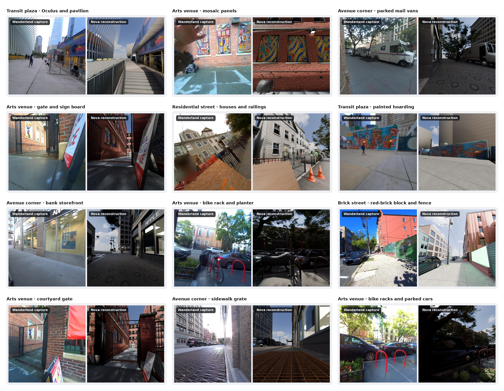

# Interactive Real-to-Sim Environments for Embodied AI

**Building on [Wanderland](https://ai4ce.github.io/wanderland/)'s real-world urban captures, we release 20 outdoor simulation environments reconstructed with [Nova3D](https://nova3d.xyz/robotics), adding object-level semantics, articulated mechanisms, physical properties, and editable scene programs.**

Nova3D generates and executes procedural code from the released observations. The resulting programs define individual objects and parts, their geometry and labels, collision shapes, physical properties, and joints. Researchers can edit these programs to vary layouts, geometry, and mechanism parameters.

The collection covers **14 street and corridor scenes, four open public spaces, a loading yard, and a parking/commercial area**.

**[Dataset and downloads on Hugging Face](https://huggingface.co/datasets/raresense/nova-wanderland)** · **[Wanderland project](https://ai4ce.github.io/wanderland/)**

*Wanderland captures beside Nova reconstructions*

## Contributions

| Component | Released content |
|---|---|
| Scene structure and semantics | Identified objects and parts, semantic classes, instance references, dimensions, and positions. |
| Articulation and physics | Hinged and sliding mechanisms, pivots, axes, limits, collision geometry, and declared body and contact properties. |
| Editable source | Python scene programs and design specifications for inspecting and changing scene construction. |
| Appearance | PBR materials, textures, and additional assets in the enhanced USD scenes. |
| Simulator exports | Isaac Sim USD, MuJoCo MJCF, Gazebo SDF, and PyBullet files, plus a base GLB. |
| Reconstruction inputs | Supplied images, image-sequence videos, scan-derived inputs where used, and preparation records. |

## Inputs

Each reconstruction used **Opus 5.5**, eight original photos, and a compressed video assembled from all released images for that capture. These videos are image sequences, not original recordings. Ten scenes also received scan-derived geometry converted to GLB. Scene IDs preserve the original Wanderland capture identifiers.

## Access

The [Hugging Face dataset](https://huggingface.co/datasets/raresense/nova-wanderland) contains the scene table, source code, annotations, downloads, and file documentation. Download a complete scene folder to retain its mesh and texture dependencies. Enhanced PBR appearance is supplied in `simulation/environment_pbr.usda`; `base/model.glb` provides the base representation.

See the dataset's [citation](https://huggingface.co/datasets/raresense/nova-wanderland/blob/main/CITATION.bib) and [credits and licenses](https://huggingface.co/datasets/raresense/nova-wanderland/blob/main/CREDITS.md) when using the collection.
